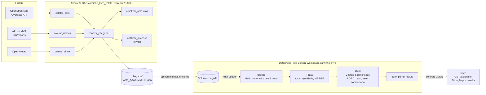

# Caminho Livre: componente Dados

Pipeline de dados do **Caminho Livre**, o mapa colaborativo de barreiras de acessibilidade em calçadas e travessias.
Global Solution FIAP 2026.2 (CitizenTech), 4ES. Entrega de **Big Data Architecture & Data Integration**.

O pipeline coleta dados reais com o Airflow, trata em camadas Bronze, Prata e Ouro no Databricks e entrega ao MVP a
**situação de cada quadra** do piloto, que o cidadão vê em https://caminholivre-gs.azurewebsites.net.

## Ficha Técnica do MVP

| Campo | Conteúdo |
|---|---|
| **Nome do produto** | Caminho Livre |
| **Cidadão e território** | Pedestres com deficiência ou mobilidade reduzida, idosos e cuidadores. O piloto cobre o entorno do campus FIAP Paulista (São Paulo, SP), cerca de 1,2 km × 1,5 km. |
| **Problema, em uma frase** | Rampas bloqueadas, calçadas obstruídas e travessias com barreira são relatadas de forma dispersa e ninguém acompanha se foram resolvidas. |
| **Proposta de valor** | O cidadão registra a barreira no mapa e acompanha o status. O gestor recebe uma fila auditável para revisar, priorizar e encerrar cada relato. |
| **Arquitetura: componentes** | MVP: página web (Leaflet) e API FastAPI no Azure App Service. **Dados (este repositório):** Airflow 3 (coleta), Databricks Free Edition (Bronze, Prata, Ouro) e contrato JSON entregue ao MVP. |
| **Fontes de dados** | (A) OpenStreetMap, via Overpass API. (B) Relatos enviados pelo próprio MVP. (C) Open-Meteo. |
| **Modelos de IA utilizados** | Nenhum neste componente. |
| **URL do MVP e repositório** | MVP: https://caminholivre-gs.azurewebsites.net. Repositório do MVP: https://github.com/santos-nikolas/caminho-livre |
| **Indicadores de impacto** | Relatos recebidos, revisados e resolvidos, taxa de revisão e de resolução e tempo até a revisão (consulta Q4). São indicadores de processo: não provam melhoria física sem verificação. |
| **ODS conectados** | ODS 10 (redução das desigualdades) e ODS 11 (metas 11.2 e 11.7: espaços públicos seguros e inclusivos). |

### Integrantes

| Nome completo | RM |
|---|---|
| Guilherme Rocha Bianchini | RM97974 |
| Nikolas Rodrigues Moura dos Santos | RM551566 |
| Thiago Jardim de Oliveira | RM551624 |
| Rodrigo Brasileiro | RM98952 |

## Perguntas que o MVP responde com estes dados

| # | Pergunta | Consulta |
|---|---|---|
| Q1 | Onde há barreiras relatadas que continuam abertas? | `vw_q1_barreiras_abertas` |
| Q2 | Em quais quadras há travessia sem nenhum rebaixamento mapeado? | `vw_q2_travessias_sem_rebaixamento` |
| Q3 | Quanto do território já tem dado de acessibilidade mapeado? | `vw_q3_cobertura_do_mapeamento` |
| Q4 | **Impacto:** os relatos estão sendo revisados e resolvidos? Em quanto tempo? | `vw_q4_impacto_fila_do_gestor` |
| Q5 | Em que dias os relatos chegam, e a chuva muda isso? | `vw_q5_relatos_por_dia_e_chuva` |

## Arquitetura



O Databricks Free Edition não se conecta ao Airflow nem aceita conexão de fora. Por isso a entrada é o envio dos arquivos
ao Volume pela interface, e a saída para o MVP é um arquivo com formato fixado em contrato.

### Fontes

| Fonte | Origem | Formato | Frequência | Chave de API |
|---|---|---|---|---|
| OpenStreetMap (travessias, meios-fios, calçadas) | Externa, dado aberto (ODbL), Overpass API | JSON, lista `elements` | diária, 06h | não exige |
| Relatos de barreiras | API pública do MVP | JSON, lista `itens` | diária, 06h | não exige |
| Clima (chuva e temperatura por hora) | Externa, Open-Meteo (CC BY 4.0) | JSON, listas paralelas | diária, 06h | não exige |

### Camadas

| Camada | Tabelas | O que acontece |
|---|---|---|
| Bronze | `bronze_osm`, `bronze_relatos`, `bronze_clima`, `bronze_controle_cargas` | Auto Loader com checkpoint: uma linha por arquivo, JSON bruto. Só entra arquivo novo. |
| Prata | `prata_osm_elemento`, `prata_relato`, `prata_clima_hora`, `prata_qualidade`, `prata_rejeitados` | Tipos e domínios, 5 regras de qualidade com contagem, quarentena e MERGE pela chave. |
| Ouro | `fato_relato`, `fato_elemento_via`, `dim_celula`, `dim_data`, `dim_categoria`, `dim_status`, `dim_classe_elemento`, `ouro_painel_celula` | Modelo estrela, dados pessoais protegidos e a tabela que o MVP consome. |

### LGPD

- O relato é o único dado ligado a uma pessoa. Na Ouro, o identificador vira hash SHA-256 com sal, a coordenada dá lugar à
  quadrícula (~100 m), a descrição livre não entra e o horário é reduzido a dia e hora.
- O sal do hash é digitado em um widget do notebook 03 e não fica no repositório.
- A consulta ao OpenStreetMap não pede o nome de quem mapeou.
- O que vai para o MVP (`ouro_painel_celula`) é agregado por quadrícula.
- Este repositório não tem chave, senha nem dado pessoal real. A pasta `chegada/` e o `variables.json` estão no `.gitignore`.

### Contrato com o MVP

O notebook 05 exporta `ouro_painel_celula` no formato de [`contrato/ouro_painel_celula.schema.json`](contrato/ouro_painel_celula.schema.json).
O arquivo entra no repositório do MVP em `app/dados/ouro_painel_celula.json`, passa pelo pipeline de deploy e é servido em
`GET /api/painel`. A página mostra os dados na seção **Situação por quadra** e como quadras coloridas no mapa.

## Estrutura do repositório

```
dags/caminho_livre_coleta.py        DAG do Airflow (coleta diária das três fontes)
databricks/00_preparar_ambiente.sql esquema e Volumes
databricks/01_bronze_auto_loader.py Bronze incremental
databricks/02_prata_tratamento_merge.py  Prata: tipos, regras de qualidade, MERGE
databricks/03_ouro_modelo_dimensional.py Ouro: fatos, dimensões, LGPD, painel do MVP
databricks/04_consultas_mvp.sql     as cinco consultas SQL
databricks/05_entrega_mvp_e_evidencias.py  exporta o contrato para o MVP e as evidências
contrato/                           formato do arquivo entregue ao MVP
amostras/                           um pouco de cada fonte (gerado pelo DAG)
relatorio/                          gerador do relatório em PDF
docker-compose.yml                  Airflow 3 local
variables.exemplo.json              modelo das Variables do Airflow (sem segredo)
```

MongoDB não foi usado: as três fontes são lidas direto pelo lakehouse.

## Como reproduzir

Pré-requisitos: Docker com Compose v2 e uma conta no [Databricks Free Edition](https://www.databricks.com/learn/free-edition).

### 1. Coleta no Airflow

```bash
git clone https://github.com/othigasdev/caminho-livre-dados.git && cd caminho-livre-dados
echo "AIRFLOW_UID=$(id -u)" > .env       # só no Linux; no Windows e no macOS não precisa
docker compose up -d                      # Airflow em http://localhost:8080 (leva 1 a 2 minutos)
```

Configure as Variables (as fontes não exigem chave; o único segredo é a URL do tópico de notificação):

```bash
cp variables.exemplo.json variables.json   # edite: troque o tópico do ntfy.sh pelo da equipe
docker compose cp variables.json airflow:/tmp/variables.json
docker compose exec airflow airflow variables import /tmp/variables.json
```

Também dá para criar pela tela, em **Admin > Variables**. Sem a `ntfy_topic_secret`, a notificação sai só no log.

Na lista de DAGs, ative o `caminho_livre_coleta`. Ele roda todo dia às 06h e, por ter `catchup`, recupera sozinho os
dias desde 10/11/2026. Cada execução grava três arquivos, com o dia de referência (D-1) no nome:

```
chegada/osm/osm_2026-11-14.json
chegada/relatos/relatos_2026-11-14.json
chegada/clima/clima_2026-11-14.json
```

O clima é o do dia de referência. OpenStreetMap e relatos são o retrato do momento da coleta: as duas APIs não guardam
histórico, então as execuções recuperadas pelo `catchup` trazem o mesmo retrato, e a Prata descarta as repetições (regra Q5).

### 2. Databricks: ambiente e 1º lote

1. Importe a pasta `databricks/` no workspace (**Workspace > Create > Git folder** com a URL deste repositório, ou
   **Import** dos arquivos).
2. Rode `00_preparar_ambiente`.
3. No **Catalog**, abra `workspace > caminho_livre > chegada`, crie as pastas `osm`, `relatos` e `clima` e envie
   (**Upload to this volume**) os arquivos do **1º lote**, cada um na pasta da sua fonte.
4. Rode `01_bronze_auto_loader`. Rode de novo, sem enviar nada: `arquivos_novos` fica 0.
5. Rode `02_prata_tratamento_merge`.

### 3. 2º lote

1. Em outro dia de coleta, envie ao Volume só os arquivos novos de `chegada/`.
2. Rode `01_bronze_auto_loader`: só os arquivos novos entram.
3. Rode `02_prata_tratamento_merge`: o MERGE insere o que é novo e atualiza o que mudou.

### 4. Ouro, consultas e entrega

1. Rode `03_ouro_modelo_dimensional`. Antes, preencha o widget `salt_hash` com um texto secreto de 16 ou mais caracteres.
2. Rode `04_consultas_mvp`.
3. Rode `05_entrega_mvp_e_evidencias` e baixe do Volume `entrega` os arquivos `ouro_painel_celula.json` e `evidencias.json`.
4. Copie `ouro_painel_celula.json` para `app/dados/` no repositório do MVP e faça o push: o pipeline publica e a seção
   **Situação por quadra** passa a mostrar os dados.

### 5. Relatório

```bash
# coloque evidencias.json em relatorio/ e os prints em relatorio/prints/ (nomes em relatorio/prints/LEIA-ME.md)
python relatorio/gerar_relatorio.py
# abra relatorio/relatorio-big-data.html no navegador > Imprimir > Salvar como PDF
```

O script lista no terminal o que ainda falta.

## Limites conhecidos

- O piloto tem poucos relatos, e parte é de demonstração (`fonte = sintetico`, identificada em todas as camadas).
- "Não mapeado" no OpenStreetMap não quer dizer que a rampa não existe. O nível de atenção é uma sugestão de prioridade;
  quem decide a vistoria é o gestor.
- A API de relatos expõe só a última mudança de status: o tempo até a revisão é uma aproximação.
- Um elemento apagado do OpenStreetMap continua na Prata com a última `data_referencia` em que apareceu.
